# Day 2 – Application Binary Interface (ABI), Memory Addressing and RISC-V Assembly Programming

## Index

1. [Introduction to Application Binary Interface (ABI)](#1-introduction-to-application-binary-interface-abi)
2. [Little Endian and Big Endian](#2-little-endian-and-big-endian)
3. [Introduction to RISC-V Instruction Formats](#3-introduction-to-risc-v-instruction-formats)
4. [Lab – C Programming, Assembly Language and RISC-V Execution](#4-lab--c-programming-assembly-language-and-risc-v-execution)
5. [Learning Outcomes](#5-learning-outcomes)

---

## 1. Introduction to Application Binary Interface (ABI)

An Application Binary Interface (ABI) defines how compiled programs interact with the operating system and other compiled software at the binary level.

Applications are developed using programming languages such as C and C++. They use standard libraries and APIs to access different system functionalities.

The ABI defines important conventions such as:

* How function arguments are passed through registers.
* How function return values are handled.
* How registers are used and preserved.
* How the stack is organized.
* How functions communicate with each other.

### Understanding the software-to-hardware flow

The following flow explains how a high-level program eventually becomes instructions executed by hardware.

1. **Application Software:** Programs are written using languages such as C and C++.
2. **Compiler:** The compiler translates the high-level source code into machine-level instructions.
3. **ABI:** Defines the binary-level conventions for communication between compiled programs, libraries and the operating system.
4. **ISA (Instruction Set Architecture):** Defines the instructions that a processor understands, such as ADD, LOAD, STORE and BRANCH.
5. **RTL (Register Transfer Level):** Describes the hardware logic that implements the processor's instructions.
6. **Hardware:** The processor executes the instructions using its registers, ALU, memory interface and control logic.

The ISA is the interface between software instructions and processor hardware, while RTL describes the hardware implementation of those instructions.

---

## 2. Little Endian and Big Endian

Endianness describes how the bytes of a multi-byte data value are arranged in memory.

### A. Little Endian

In Little Endian representation, the least significant byte (LSB) is stored at the lowest memory address.

### B. Big Endian

In Big Endian representation, the most significant byte (MSB) is stored at the lowest memory address.

For example, consider a 32-bit hexadecimal value:

`0x12345678`

| Memory Address | Little Endian | Big Endian |
| -------------- | ------------- | ---------- |
| 1000           | 78            | 12         |
| 1001           | 56            | 34         |
| 1002           | 34            | 56         |
| 1003           | 12            | 78         |

**Observation:**

* Little Endian stores the least significant byte first.
* Big Endian stores the most significant byte first.
* Endianness changes the byte arrangement in memory, not the actual numerical value.

---

## 3. Introduction to RISC-V Instruction Formats

In RISC-V, instructions are encoded using different formats depending on the operation being performed.

In this experiment, we studied three important instruction formats:

### 3.1 I-Type Instructions – Load Operations

I-type instructions are commonly used for immediate operations and loading data from memory.

Example:

```assembly
ld x8, 16(x23)
```

Explanation:

| Field | Description                |
| ----- | -------------------------- |
| `ld`  | Load Doubleword            |
| `x8`  | Destination register (rd)  |
| `16`  | Immediate offset           |
| `x23` | Base/source register (rs1) |

**Working:**

1. Initially, assume the contents of `x23` are zero.
2. The immediate offset 16 is added to the contents of `x23`.
3. The effective memory address becomes `0 + 16 = 16`.
4. The 64-bit data stored at that memory location is loaded into destination register `x8`.

The effective address is:

`Effective Address = rs1 + Immediate`

Other load instructions:

| Instruction | Description            |
| ----------- | ---------------------- |
| `lb`        | Load Byte (signed)     |
| `lh`        | Load Halfword (signed) |
| `lw`        | Load Word (signed)     |
| `ld`        | Load Doubleword        |
| `lbu`       | Load Byte Unsigned     |
| `lhu`       | Load Halfword Unsigned |

**Instruction Format:**

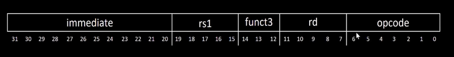

---

### 3.2 R-Type Instructions – Register Operations

R-type instructions are used for operations involving two source registers.

Example:

```assembly
add x8, x24, x8
```

Explanation:

| Field | Description                  |
| ----- | ---------------------------- |
| `add` | Addition operation           |
| `x8`  | Destination register (rd)    |
| `x24` | First source register (rs1)  |
| `x8`  | Second source register (rs2) |

**Working:**

1. Read the contents of register `x24`.
2. Read the contents of register `x8`.
3. Add both values.
4. Store the result in destination register `x8`.

The operation is:

`x8 = x24 + x8`

**Instruction Format:**

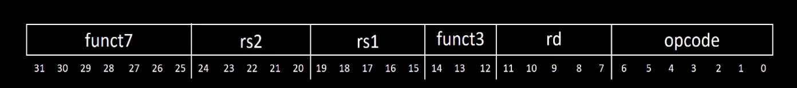

---

### 3.3 S-Type Instructions – Store Operations

S-type instructions are used to store data from a register into memory.

Example:

```assembly
sd x8, 8(x23)
```

Explanation:

| Field | Description           |
| ----- | --------------------- |
| `sd`  | Store Doubleword      |
| `x8`  | Source register (rs2) |
| `8`   | Immediate offset      |
| `x23` | Base register (rs1)   |

**Working:**

1. Assume the contents of `x23` are zero.
2. Add the immediate offset 8 to the contents of `x23`.
3. The effective memory address becomes 8.
4. The 64-bit data stored in register `x8` is written into memory at address 8.

The effective address is:

`Effective Address = rs1 + Immediate`

Unlike I-type instructions, S-type instructions do not contain a destination register (rd). They use rs1 and rs2 as source registers.

**Instruction Format:**

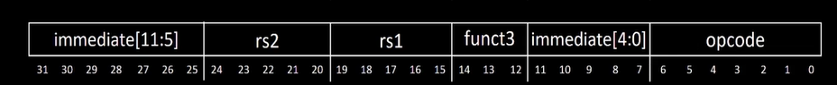

---

### 3.4 RISC-V Register Unit

RISC-V provides 32 general-purpose integer registers in its standard integer register file.

Since each register is identified using 5 bits:

`Number of registers = 2^5 = 32`

These registers are numbered from `x0` to `x31`.

Each register has a specific ABI name and purpose.

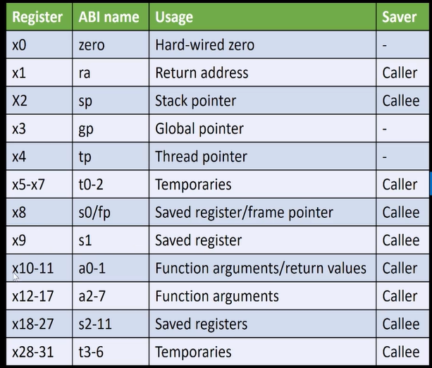

---

## 4. Lab – C Programming, Assembly Language and RISC-V Execution

In this experiment, we implemented a summation program using a combination of C programming and RISC-V assembly language.

The objective was to understand how a C function can call an assembly function, how registers are used to pass arguments and return values, and how the processor executes the instructions.

### 4.1 Writing the C Program and Assembly Code

We created two files:

* `1to9_custom.c` – Contains the main C program.
* `load.S` – Contains the RISC-V assembly implementation of the load function.

**C Program: `1to9_custom.c`**

```c
#include <stdio.h>

extern int load(int x, int y);

int main() {
    int result = 0;
    int count = 9;

    result = load(0x0, count+1);

    printf("sum of numbers from 1 to %d is %d\n",
           count, result);

    return 0;
}
```

**Assembly Program: `load.S`**

```assembly
.section .text
.global load
.type load, @function

load:
    add  a4, a0, zero    // Initialize a4 = 0
    add  a2, a0, a1     // Store count of 10 in a2
    add  a3, a0, zero   // Initialize a3 = 0

loop:
    add  a4, a3, a4     // Accumulate the sum
    addi a3, a3, 1      // Increment a3 by 1
    blt  a3, a2, loop   // If a3 < a2, repeat loop
    add  a0, a4, zero   // Move final result into a0
    ret
```

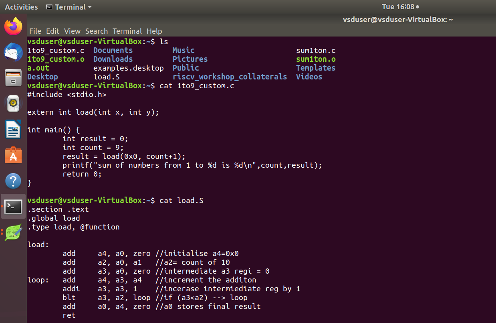

### Understanding `extern int load(int x, int y)`

The `extern` keyword declares a function that is defined in another source file.

Here, the `load()` function is not implemented in the C program. Instead, its implementation is provided in the assembly file `load.S`.

The C program calls the assembly function, and the function executes using RISC-V instructions.

According to the RISC-V ABI:

* The first argument is passed through register `a0`.
* The second argument is passed through register `a1`.
* The return value is placed in register `a0`.

In our program:

* `a0 = 0`
* `a1 = 10`

The assembly function performs the accumulation and returns the result through `a0`.

### 4.2 Understanding the Assembly Flowchart

The following flowchart explains the execution of the assembly program.

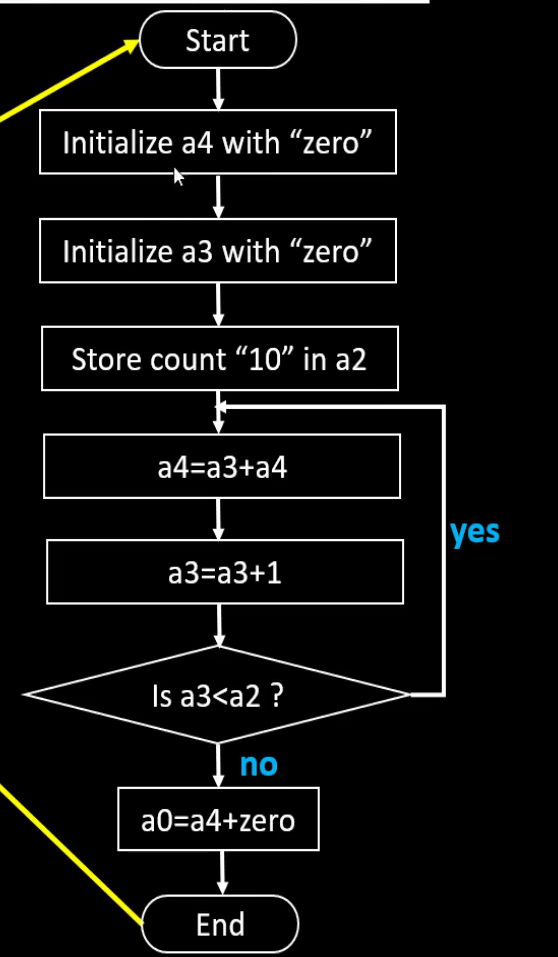

**Explanation of registers used:**

| Register | Purpose                               |
| -------- | ------------------------------------- |
| `a0`     | First argument and final return value |
| `a1`     | Second argument                       |
| `a2`     | Stores the loop limit (10)            |
| `a3`     | Intermediate counter                  |
| `a4`     | Accumulator that stores the sum       |

**Execution steps:**

1. Initialize `a4` with zero.
2. Store the loop limit 10 in `a2`.
3. Initialize `a3` with zero.
4. Add the value of `a3` to the accumulator `a4`.
5. Increment `a3` using the ADDI instruction.
6. Check whether `a3` is less than `a2` using BLT.
7. If the condition is true, repeat the loop.
8. Otherwise, move the final result into `a0`.
9. Execute RET to return control to the C program.

**Note:** The assembly code accumulates the values from 0 to 9. Since zero does not change the sum, the final result is 45, which is also the sum from 1 to 9.

### 4.3 Compiling the C and Assembly Programs

We compile both files together using the RISC-V GCC cross-compiler.

**Command:**

```bash
riscv64-unknown-elf-gcc -mabi=lp64 -march=rv64i -o 1to9_custom.o 1to9_custom.c load.S
```

**Explanation of the command:**

| Command / Option          | Description                                     |
| ------------------------- | ----------------------------------------------- |
| `riscv64-unknown-elf-gcc` | RISC-V 64-bit cross-compiler                    |
| `-mabi=lp64`              | Specifies the LP64 application binary interface |
| `-march=rv64i`            | Targets the RV64I base integer instruction set  |
| `-o 1to9_custom.o`        | Specifies the output file name                  |
| `1to9_custom.c`           | Input C source file                             |
| `load.S`                  | Input assembly source file                      |

This command compiles the C program and assembly code and links them into the output executable.

### 4.4 Running the Program Using Spike

Spike is a RISC-V ISA simulator used to execute and verify RISC-V programs.

**Command:**

```bash
spike pk 1to9_custom.o
```

**Explanation:**

* `spike` launches the RISC-V ISA simulator.
* `pk` uses the proxy kernel to provide the environment needed to execute the program.
* `1to9_custom.o` is the compiled RISC-V executable.

**Output:**

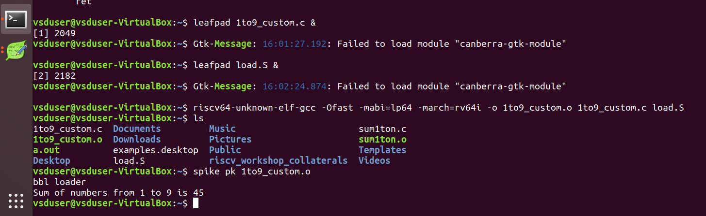

The program executes successfully in the Spike simulator and displays the calculated sum.

### 4.5 Disassembling the Executable Using Objdump

To understand which RISC-V instructions were generated by the compiler, we use the `objdump` utility.

**Command:**

```bash
riscv64-unknown-elf-objdump -d 1to9_custom.o | less
```

**Explanation:**

| Command                       | Description                                    |
| ----------------------------- | ---------------------------------------------- |
| `riscv64-unknown-elf-objdump` | RISC-V object file disassembler                |
| `-d`                          | Displays the disassembled machine instructions |
| `1to9_custom.o`               | Input executable                               |
| `\|`                          | Passes the output to another command           |
| `less`                        | Allows scrolling through the output            |

The disassembled output displays the machine instructions along with their memory addresses.

This helps us understand how the C and assembly programs are translated into RISC-V instructions.

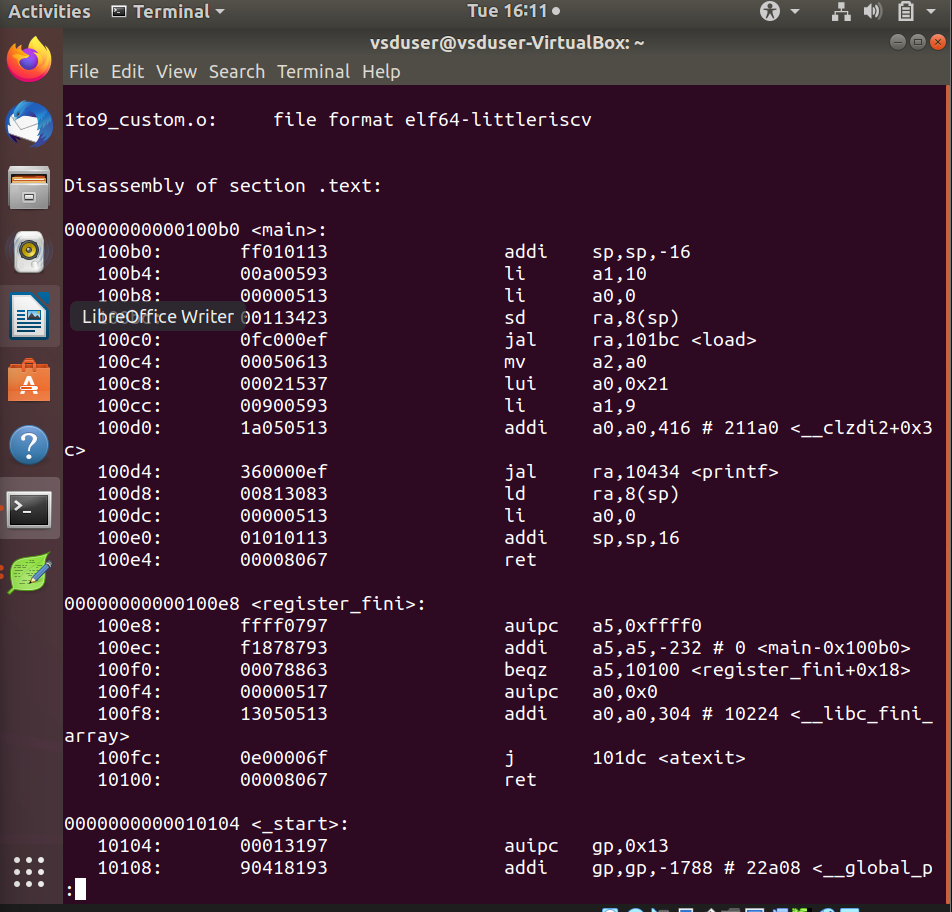

### 4.6 Generating the HEX File Using rv32im.sh

Next, we moved to the workshop collateral directory to execute the provided script.

**Commands:**

```bash
cd ../riscv_workshop_collaterals/labs
```

Moves into the labs directory containing the workshop scripts.

```bash
chmod 777 rv32im.sh
```

Provides execute permission to the shell script.

```bash
./rv32im.sh
```

Executes the script.

The script performs the operations configured in the workshop environment and generates the corresponding output files.

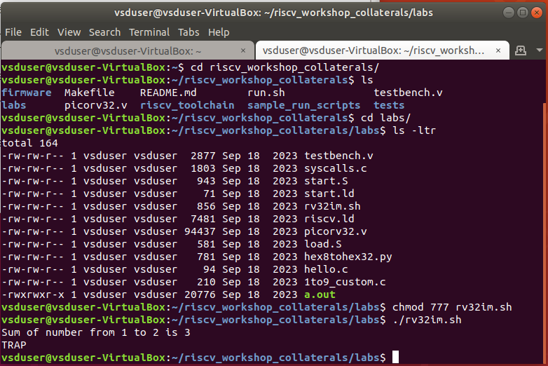

### 4.7 Verifying the Generated HEX File

After executing the script, we checked the generated HEX file to understand the output produced by the conversion process.

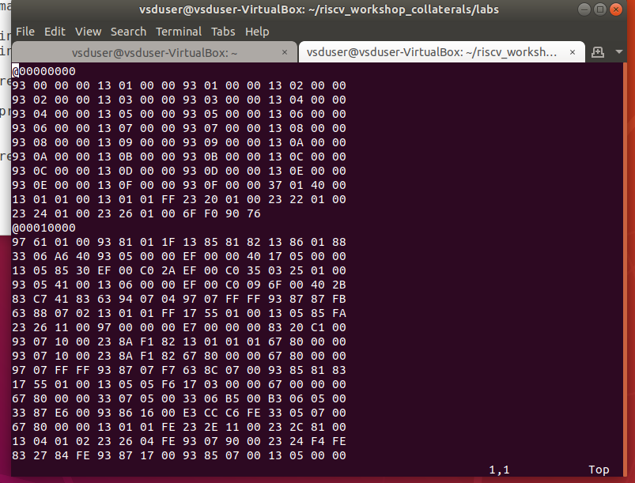

The HEX representation helps us inspect the machine-level data generated for the processor.

### 4.8 Understanding HEX32 Output

We also inspected the HEX32 output generated during the experiment.

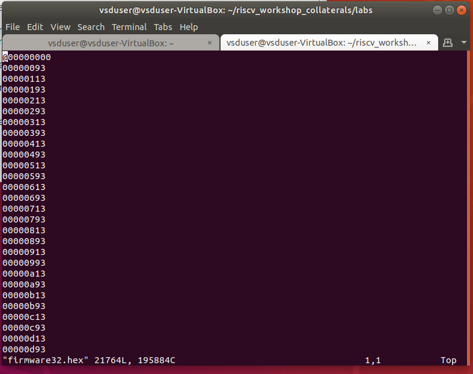

This step helped us understand how the generated program data is represented in hexadecimal form for use in the processor environment.

---

## 5. Learning Outcomes

Through this experiment, I learned:

1. **Application Binary Interface (ABI):** Understood how compiled programs communicate using registers, function arguments, return values and stack conventions.

2. **Endianness:** Learned the difference between Little Endian and Big Endian memory representations.

3. **RISC-V Instruction Formats:** Understood I-type, R-type and S-type instructions and how their fields are used.

4. **Register Organization:** Learned about the 32 general-purpose registers and their ABI names and functions.

5. **C and Assembly Integration:** Understood how a C program can call an assembly function using the `extern` declaration.

6. **Assembly Programming:** Practiced instructions such as ADD, ADDI, BLT and RET to implement a loop and perform accumulation.

7. **RISC-V Compilation:** Learned to compile C and assembly files using the RISC-V GCC cross-compiler.

8. **Spike Simulation:** Executed the compiled program using Spike and verified the program output.

9. **Disassembly:** Used Objdump to inspect the generated RISC-V instructions and their addresses.

10. **HEX Generation:** Explored the workshop script and examined the generated hexadecimal output.

### Conclusion

This experiment provided practical exposure to the connection between high-level C programming, assembly language and RISC-V hardware architecture. By implementing a function in assembly and calling it from C, I understood how ABI conventions enable communication between different software components. I also learned how instructions are compiled, simulated, disassembled and represented in hexadecimal format, giving me a better understanding of the software-to-hardware execution flow in RISC-V.

