# Day 1 - Introduction to RISC-V ISA and GNU Compiler Toolchain

## Index

1. [Introduction to RISC-V Instruction Set](#1-introduction-to-risc-v-instruction-set)
2. [Types of RISC-V Instructions](#2-types-of-risc-v-instructions)
3. [Lab - Compilation and Simulation](#3-lab---compilation-and-simulation)
4. [Debugging RISC-V Program Using Spike](#4-debugging-risc-v-program-using-spike)
5. [Understanding Signed and Unsigned Integer Representation](#5-Understanding-signed-and-unsigned-integer-representation)
6. [Learning Outcomes](#6-learning-outcomes)

---

# 1. Introduction to RISC-V Instruction Set

RISC-V (Reduced Instruction Set Computer - Five) is an open-standard Instruction Set Architecture (ISA). It defines the instructions that a processor can understand and execute.

An ISA acts as an interface between software and hardware. It provides a common specification that software developers and hardware designers follow while developing applications and processor architectures.

### Understanding the Software-to-Hardware Flow

The following diagram illustrates how application software communicates with the hardware through system software and the instruction set.

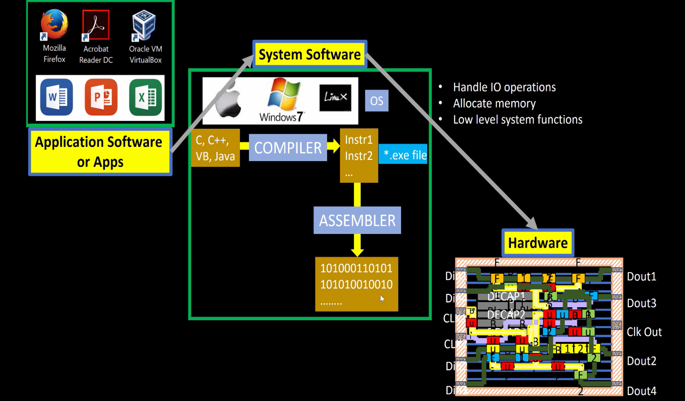

### Working Principle

1. **Application Software:** Applications are written using high-level programming languages such as C and C++.

2. **Compiler:** The compiler translates high-level source code into instructions suitable for the target processor.

3. **Assembler:** The assembler converts assembly instructions into machine-code instructions represented in binary.

4. **System Software:** The operating system and other system-level software manage resources such as memory, I/O operations and low-level system functions.

5. **Hardware:** The processor executes the machine instructions and performs the required operations.

The GNU toolchain performs additional stages such as preprocessing, assembling and linking to generate an executable program. The resulting executable is stored in an ELF format in this RISC-V toolchain flow.

The ISA defines the instructions understood by the processor, forming the connection between software and hardware.

---

# 2. Types of RISC-V Instructions

RISC-V follows a modular instruction-set architecture. It has a base integer instruction set and optional extensions that provide additional functionality.

### A. Pseudo Instructions

Pseudo instructions are assembly-language shortcuts provided by the assembler. They make assembly programs easier to read and write. They are translated into one or more actual machine instructions.

| Instruction | Description |
|---|---|
| `mv` | Moves data from one register to another. |
| `li` | Loads a constant value into a register. |
| `ret` | Returns control to the calling function. |

For example:

- `mv` can be translated into an `addi` instruction.
- `li` may expand into one or more instructions depending on the constant.
- `ret` is an alias for `jalr x0, 0(ra)`.

### B. Base Integer Instructions - RV64I

RISC-V naming convention:

- **RV** - RISC-V.
- **64** - 64-bit integer register width (XLEN = 64).
- **I** - Base integer instruction set.

The RV64I base instruction set provides arithmetic, logical, data-transfer and control-flow operations.

| Instruction | Description |
|---|---|
| `AUIPC` | Adds an upper immediate value to the program counter and stores the result in a register. |
| `JALR` | Performs an indirect jump and stores the return address. |
| `LUI` | Loads an upper immediate value into a register. |
| `ADDI` | Adds an immediate value to a register. |
| `LW` | Loads a 32-bit word from memory and sign-extends it to 64 bits. |
| `ADDW` | Adds two 32-bit values and sign-extends the result to 64 bits. |
| `SD` | Stores a 64-bit value from a register into memory. |

### C. Multiplication Extension - RV64M

The M extension adds multiplication and division operations to the base integer instruction set.

| Instruction | Description |
|---|---|
| `MULW` | Multiplies two 32-bit values and sign-extends the lower 32-bit result to 64 bits. |
| `DIVW` | Performs signed division on 32-bit values and sign-extends the result to 64 bits. |

**Note:** Combining the base integer instruction set and multiplication/division extension gives:

`RV64I + RV64M = RV64IM`

### D. Floating-Point Extensions - RV64F and RV64D

RISC-V supports floating-point operations through optional extensions.

**1. RV64F - Single-Precision Floating Point**

The F extension supports 32-bit floating-point operations.

| Instruction | Description |
|---|---|
| `FLW` | Loads a 32-bit floating-point value from memory. |
| `FADD.S` | Performs single-precision floating-point addition. |
| `FMUL.S` | Performs single-precision floating-point multiplication. |
| `FDIV.S` | Performs single-precision floating-point division. |
| `FMV.X.W` | Moves the bit representation of a single-precision value into an integer register. |

**2. RV64D - Double-Precision Floating Point**

The D extension supports 64-bit floating-point operations.

| Instruction | Description |
|---|---|
| `FLD` | Loads a 64-bit double-precision floating-point value from memory. |
| `FMV.X.D` | Moves the bit representation of a double-precision value into an integer register on RV64. |

**Note:** `FMUL.S` and `FDIV.S` belong to the F extension, whereas `FLD` and `FMV.X.D` belong to the D extension.

Combining the integer, multiplication/division and floating-point extensions gives:

`RV64I + M + F + D = RV64IMFD`

### E. Application Binary Interface (ABI)

The Application Binary Interface (ABI) defines how software interacts with the processor at the binary level. It specifies register usage, function calling conventions, stack management and data representation.

Some important RISC-V ABI register names are:

| ABI Name | Register | Purpose |
|---|---|---|
| `a0` | x10 | Function argument and return value |
| `sp` | x2 | Stack pointer |
| `ra` | x1 | Return address |
| `s0` | x8 | Saved register / frame pointer |

### F. Memory Allocation and Stack Pointer

The stack is a memory region used for storing temporary data, function-call information, local variables and saved registers.

The stack pointer (`sp`) holds the address of the current top of the stack.

In RISC-V, the stack grows towards lower memory addresses.

Example:

```asm
addi sp, sp, -32
```

This instruction decreases the stack pointer by 32 bytes, allocating 32 bytes of stack space.

To restore the stack pointer:

```asm
addi sp, sp, 32
```

This releases the allocated 32 bytes.

The stack pointer is important when functions are called, local variables are stored and return addresses or saved registers need to be preserved.

---

# 3. Lab - Compilation and Simulation

In this lab, a simple C program that calculates the sum of numbers from 1 to N was used to understand the RISC-V GNU compiler toolchain.

The same program was compiled using the native GCC compiler and then using the RISC-V cross-compiler. Different optimization levels were also explored.

### A. Ubuntu 18 Setup

Ubuntu 18 was downloaded and installed using the provided workshop instructions. Leafpad was used as the text editor to create and edit the C program.

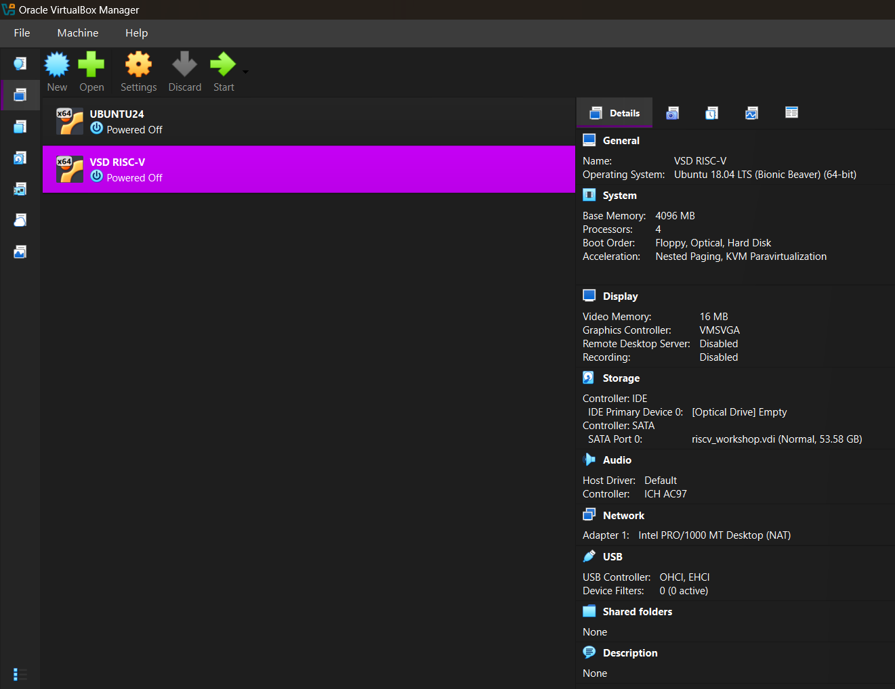

### B. Writing and Executing the C Program

First, the C program was created using Leafpad.

**Commands:**

```bash
leafpad sum1ton.c
gcc sum1ton.c
./a.out
```

**Command Explanation:**

| Command | Description |
|---|---|
| `leafpad sum1ton.c` | Opens Leafpad to create or edit the C source file. |
| `gcc sum1ton.c` | Compiles the C program using the native GCC compiler. By default, it generates an executable named `a.out`. |
| `./a.out` | Executes the generated program. |

The program calculates the sum of integers from 1 to N and displays the result.

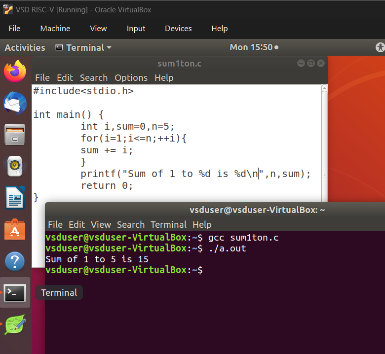

### C. Compilation Using RISC-V GCC - O1 Optimization

Next, the same C program was compiled using the RISC-V cross-compiler.

**Command:**

```bash
riscv64-unknown-elf-gcc -O1 -mabi=lp64 -march=rv64i -o sum1ton.o sum1ton.c
```

**Command Explanation:**

| Option | Description |
|---|---|
| `riscv64-unknown-elf-gcc` | RISC-V cross-compiler used to generate code for a RISC-V target. |
| `-O1` | Enables level 1 compiler optimization. |
| `-mabi=lp64` | Specifies the LP64 ABI with 64-bit long integers and pointers. |
| `-march=rv64i` | Targets the RV64I base integer instruction set. |
| `-o sum1ton.o` | Specifies the output filename. |
| `sum1ton.c` | Input C source file. |

**Note:** Although the output is named `sum1ton.o`, this command does not use `-c`. Therefore, the compiler driver produces a linked executable rather than a relocatable object file. The filename extension does not determine the file type.

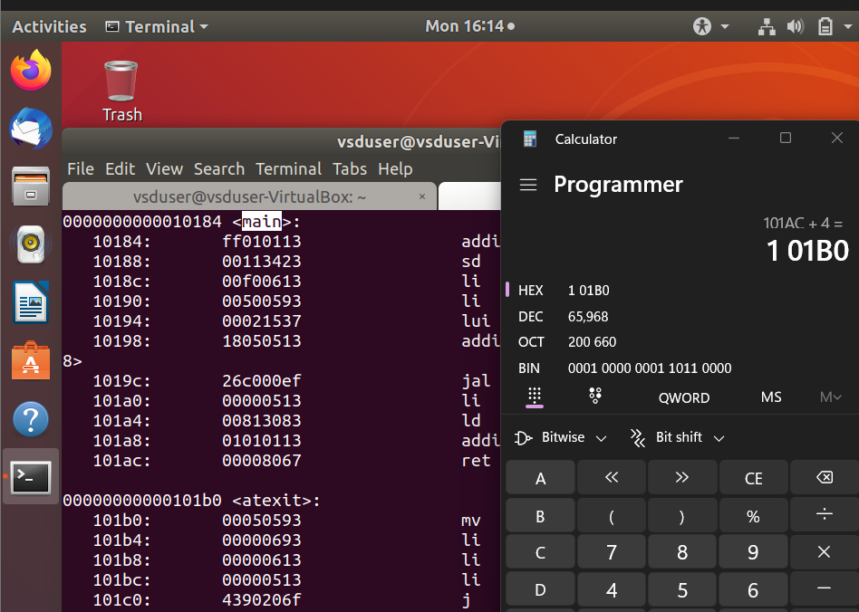

### D. Verifying the Number of Instructions

After compilation, the generated RISC-V executable was inspected to identify the instruction addresses.

The instruction addresses were used to estimate the number of instructions generated by the compiler.

For the RV64I target used here, standard instructions are 32 bits (4 bytes) long.

**Calculation:**

```text
Number of instructions =
(Last instruction address - First instruction address) / 4 + 1
```

The `+1` includes the instruction at the starting address.

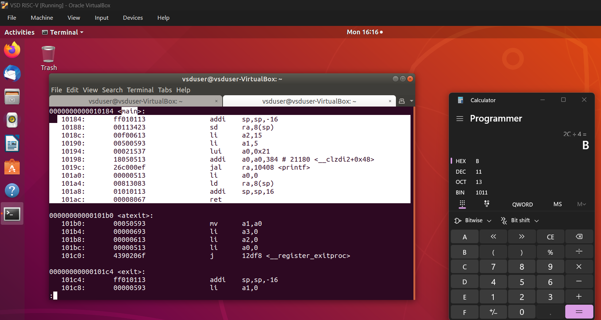

This helps understand how many machine instructions are generated for the C program.

### E. Compilation Using -Ofast Optimization

The same program was compiled again using the `-Ofast` optimization option.

**Command:**

```bash
riscv64-unknown-elf-gcc -Ofast -mabi=lp64 -march=rv64i -o sum1ton.o sum1ton.c
```

**Explanation:**

- `-Ofast` enables aggressive optimization options beyond the normal `-O3` level.
- It can apply transformations that may not preserve strict floating-point and language-standard behavior.
- The compiler attempts to improve execution performance and reduce unnecessary operations.

The generated instruction sequence was inspected again to understand the impact of optimization on the program.

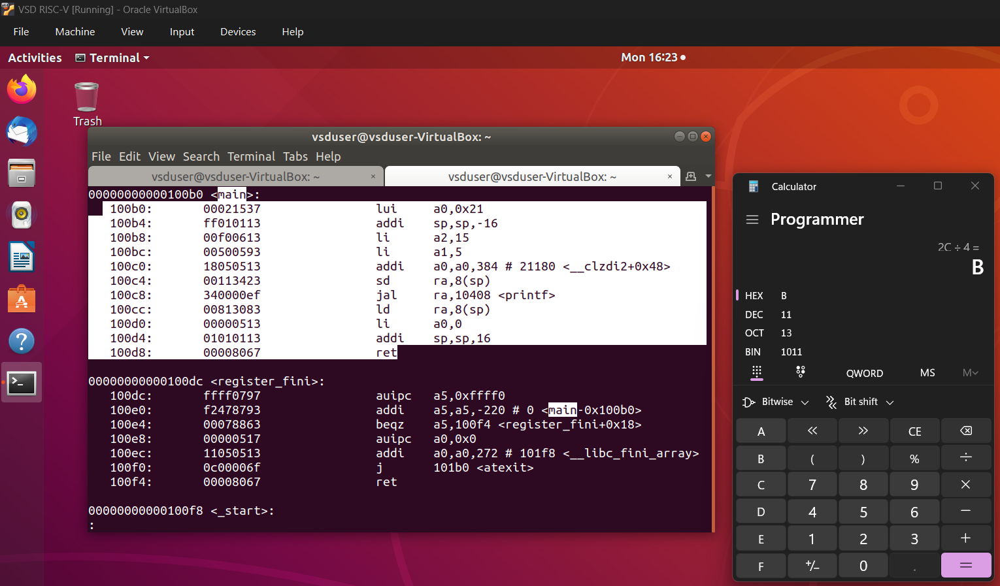

### F. Disassembling the RISC-V Executable

The `objdump` utility was used to convert the executable instructions into a readable assembly/disassembly format.

**Command:**

```bash
riscv64-unknown-elf-objdump -d sum1ton.o | less
```

**Explanation:**

- `riscv64-unknown-elf-objdump` - RISC-V binary inspection utility.
- `-d` - Disassembles executable sections into assembly instructions.
- `sum1ton.o` - Compiled RISC-V executable.
- `|` - Sends the output of the first command to the next command.
- `less` - Displays the output page by page.

This allows us to inspect the actual RISC-V instructions generated from the original C program.

Press `q` to exit the `less` viewer.

### G. Simulating Using Spike

Finally, the generated RISC-V executable was run using the Spike RISC-V instruction-set simulator.

**Command:**

```bash
spike pk sum1ton.o
```

**Explanation:**

| Component | Description |
|---|---|
| `spike` | RISC-V ISA simulator. |
| `pk` | Proxy kernel used to provide the execution environment for the program. |
| `sum1ton.o` | Compiled RISC-V executable. |

Spike simulates the execution of the RISC-V instructions and displays the program output.

The output can be compared with the result obtained from native GCC execution to verify the program's functionality.

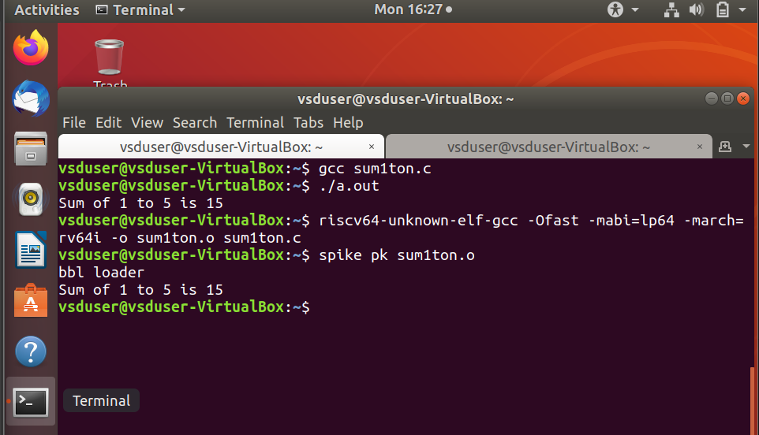

---

## 4. Debugging RISC-V Instructions Using Spike

After successfully running the C program using Spike, we used the Spike interactive debugger to understand how RISC-V instructions execute internally and how register values change after every instruction.

### 4.1 Starting the Spike Debugger

**Command:**

```bash
spike -d pk sum1ton.o
```

**Explanation:**

* `spike` – RISC-V ISA simulator.
* `-d` – Enables interactive debugging mode.
* `pk` – Proxy kernel used to execute the application.
* `sum1ton.o` – Compiled RISC-V executable.

After executing this command, the terminal enters the Spike debugging environment, represented by the `(spike)` prompt.

**Spike debugger initialization and register inspection**

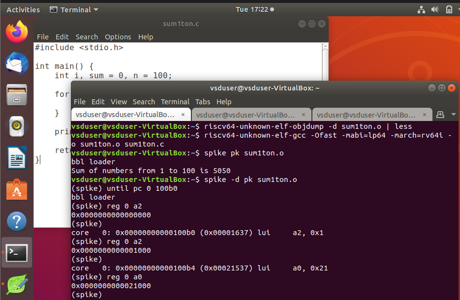

### 4.2 Understanding Program Counter and Registers

The following commands were used inside the Spike debugger:

```text
until pc 0 100b0
```

This command executes the program until the Program Counter (PC) reaches address `0x100b0` on core 0.

This address represents the initial execution location of the `main()` function in our program.

To inspect a register:

```text
reg 0 a2
```

This displays the contents of register `a2` on core 0.

Initially, the register contains:

```text
0x0000000000000000
```

This indicates that the register is initially zero.

### 4.3 Understanding LUI Instruction

Pressing Enter in the Spike debugger executes the next instruction.

The instruction executed was:

```text
lui a2, 0x1
```

**LUI – Load Upper Immediate**

LUI loads an immediate value into the upper 20 bits of a register and fills the lower 12 bits with zeros.

Therefore:

```text
lui a2, 0x1
```

Produces:

```text
a2 = 0x0000000000001000
```

Here, bit 12 is set to 1, while the lower 12 bits remain zero.

The next instruction was:

```text
lui a0, 0x21
```

This updates register `a0` with:

```text
a0 = 0x0000000000021000
```

This helped us understand how immediate values are loaded into registers during instruction execution.

### 4.4 Understanding ADDI Instruction and Stack Pointer

Next, we inspected the Stack Pointer (SP) register.

```text
reg 0 sp
```

The initial value observed was:

```text
0x0000003ffffffb50
```

The next instruction executed was:

```text
addi sp, sp, -16
```

**ADDI – Add Immediate**

ADDI adds a signed immediate value to the contents of a source register and stores the result in the destination register.

Instruction breakdown:

| Field     | Value | Description          |
| --------- | ----- | -------------------- |
| Opcode    | ADDI  | Add immediate        |
| rd        | sp    | Destination register |
| rs1       | sp    | Source register      |
| Immediate | -16   | Value to be added    |

Calculation:

```text
Initial SP = 0x3ffffffb50
Immediate  = -16 (decimal)
            = -0x10

Final SP   = 0x3ffffffb40
```

We verified the updated value using:

```text
reg 0 sp
```

The output showed:

```text
0x0000003ffffffb40
```

This confirms that the stack pointer was successfully decremented by 16 bytes.

**Stack pointer inspection and ADDI execution**

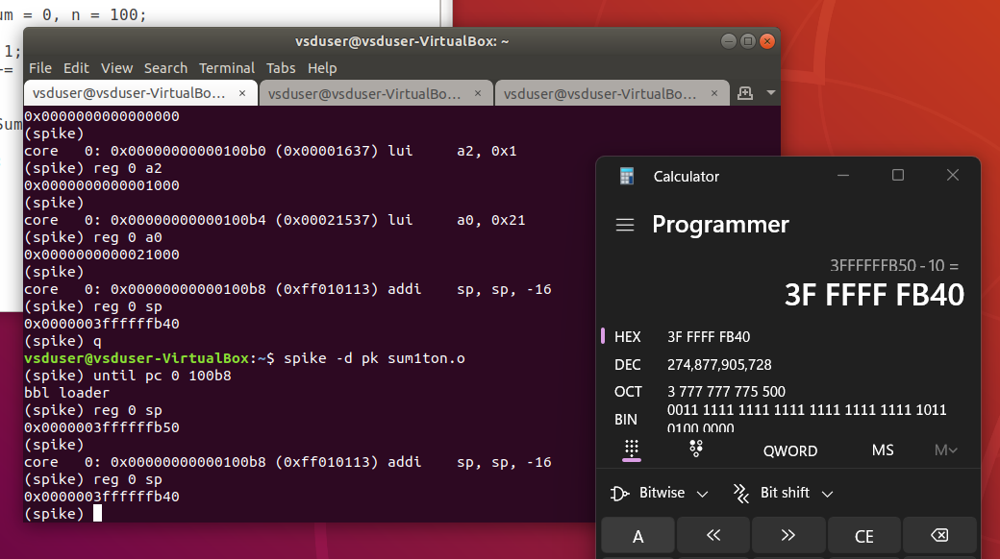

---

## 5. Understanding Signed and Unsigned Numbers in C

In this experiment, we explored how signed and unsigned integer data types represent values and how their ranges differ.

### 5.1 Understanding Unsigned Numbers

An unsigned integer stores only non-negative values.

For an N-bit unsigned number, the range is:

$$
0 \text{ to } 2^N-1
$$

For example, with 3 bits:

| Binary | Decimal |
| ------ | ------: |
| 000    |       0 |
| 001    |       1 |
| 010    |       2 |
| 011    |       3 |
| 100    |       4 |
| 101    |       5 |
| 110    |       6 |
| 111    |       7 |

Therefore, the maximum value is:

$$
2^3-1=7
$$

Similarly, for a 64-bit unsigned integer:

$$
2^{64}-1
$$

The maximum value is:

```text
18446744073709551615
```

We used the `unsigned long long int` data type to experiment with this range.

**Finding the maximum unsigned 64-bit integer**

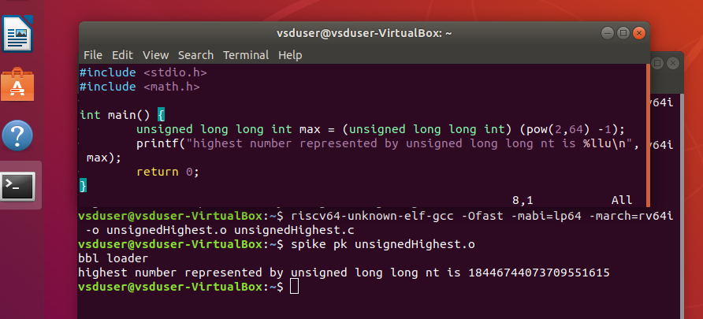

### 5.2 Understanding the 64-bit Limitation

We also experimented by changing the power from 64 to 115.

However, the `unsigned long long int` data type supports only 64 bits on our 64-bit platform.

Therefore, it cannot represent values beyond its maximum range. Values outside this range can overflow or produce unexpected results.

**Testing values beyond the 64-bit unsigned range**

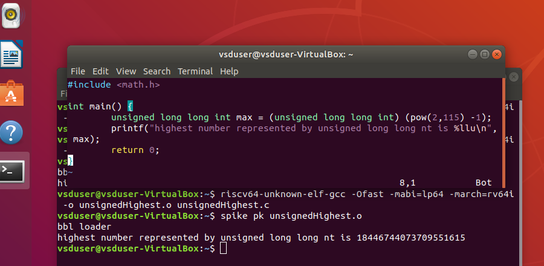

### 5.3 Comparing Signed and Unsigned Representation

We next compared the representation of the same magnitude using signed and unsigned integer data types.

For a 24-bit magnitude:

$$
2^{24}-1=16777215
$$

**Unsigned representation:**

```c
printf("%llu", value);
```

Output:

```text
16777215
```

**Signed representation:**

```c
printf("%lld", value);
```

When the corresponding negative value is stored in a signed variable, the output becomes:

```text
-16777215
```

| Representation | Data type              |    Output |
| -------------- | ---------------------- | --------: |
| Unsigned       | unsigned long long int |  16777215 |
| Signed         | long long int          | -16777215 |

The difference is that unsigned integers represent only non-negative values, whereas signed integers can represent both positive and negative values.

**Unsigned integer representation**

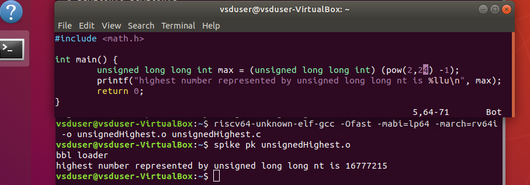

**Signed integer representation**

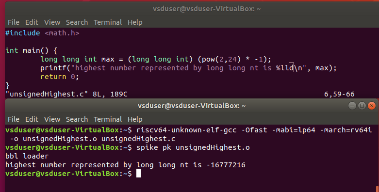

### 5.4 Finding Maximum and Minimum Signed Values

We also explored the maximum and minimum values of signed integer representations.

For a signed N-bit two's-complement integer:

$$
\text{Maximum}=2^{N-1}-1
$$

$$
\text{Minimum}=-2^{N-1}
$$

For a 64-bit signed integer:

| Parameter | Formula      |                Value |
| --------- | ------------ | -------------------: |
| Maximum   | \(2^{63}-1\) |  2147483647          |
| Minimum   | \(-2^{63}\)  | -2147483647          |


### 5.5 C Data Types, Memory and Format Specifiers

We studied the following commonly used integer data types:

| Data type              | Memory (bytes) | Format specifier |
| ---------------------- | -------------: | ---------------- |
| unsigned int           |              4 | `%u`             |
| int                    |              4 | `%d`             |
| unsigned long long int |              8 | `%llu`           |
| long long int          |              8 | `%lld`           |

---

# 6. Learning Outcomes

Through Day 1 of the RISC-V workshop, I learned:

1. **RISC-V ISA Fundamentals:** Understood how the instruction set acts as an interface between software and hardware.

2. **Instruction Classification:** Explored pseudo instructions, RV64I, RV64M and floating-point extensions RV64F and RV64D.

3. **ABI and Registers:** Understood the purpose of registers such as `a0`, `sp`, `ra` and `s0`, along with their role in function calls and program execution.

4. **GNU Compiler Toolchain:** Learned how a C program can be compiled for a RISC-V target using the cross-compiler.

5. **Compiler Optimization:** Compared `-O1` and `-Ofast` compilation and explored how optimization affects generated machine instructions.

6. **Disassembly and Simulation:** Used `objdump` to inspect generated RISC-V instructions and Spike to simulate their execution.

## Conclusion

Day 1 provided a practical understanding of how a high-level C program is translated into RISC-V machine instructions and executed by a processor.

By exploring the ISA, ABI, GNU compiler toolchain, optimization levels and Spike simulator, I gained an understanding of the software-to-hardware execution flow and the fundamentals required for learning RISC-V processor architecture.
